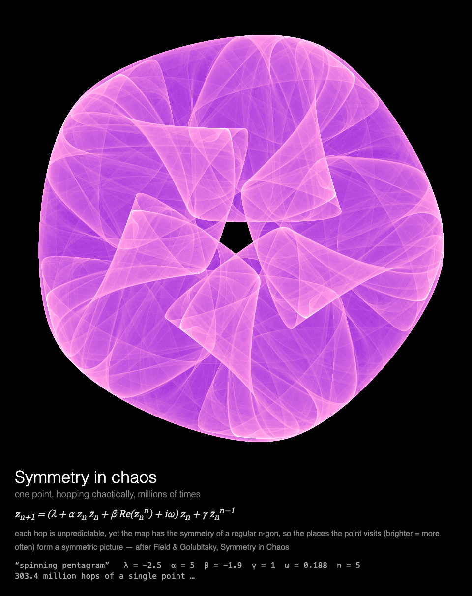

# MMM-SymmetricIcons

A [MagicMirror²](https://magicmirror.builders/) module in which one point, hopping chaotically millions of times, develops a symmetric picture (after Field and Golubitsky's *Symmetry in Chaos*), drawn for a Raspberry Pi without a GPU.



## What you see

**Symmetry in chaos.** A single point hops about the plane under one rule, millions of times.
Each hop is unpredictable, yet the rule has the symmetry of a regular polygon, so the places the
point visits build up a symmetric picture, brighter where it goes more often. The picture
develops like a photograph for 45 s, then holds. Each showing brings one of five icons (a
seven-fold flower, a spinning pentagram, a triple swirl, a square vortex, hexagonal lace), in
one of four colour ramps, chosen at random.

Under the picture: the map, a note on why the picture is symmetric, and the readout: the icon's
name and parameters, and how many million hops the point has made so far.

Built for a **Raspberry Pi 3 without GPU acceleration**: everything is drawn by the CPU, the
picture is recoloured only twice a second, the module rests once it has developed, and the
animation stops while the module is hidden (see [Performance](#performance)).

## Installation

```bash
cd ~/MagicMirror/modules
git clone https://github.com/charleswest775/MMM-SymmetricIcons
```

No npm dependencies: there is nothing to install.

## Update

```bash
cd ~/MagicMirror/modules/MMM-SymmetricIcons
git pull
```

## Configuration

```js
{
	module: "MMM-SymmetricIcons",
	position: "middle_center",
	config: {
		cycleSeconds: 600,  // longer than the page is shown: one icon per showing
		width: 900,
		height: 900,
		fps: 20
	}
},
```

The picture develops for 45 s: on a page shown for less, it is still developing when the page
moves on. The mirror it was made for shows it for 60 s.

| Option | Default | Description |
|---|---|---|
| `cycleSeconds` | `60` | Start a new icon this often; a new one also starts each time the module is shown again |
| `width`, `height` | `900` | Canvas size in pixels |
| `fps` | `20` | Frame-rate cap |
| `showMath` | `true` | Equations and live numbers under the canvas |
| `turns` | `null` | Take turns with other modules on the same page, e.g. `{ of: 2, at: 1 }` (see [Taking turns](#taking-turns)) |
| `statsPanel` | `false` | A line under the math showing what the mirror spends: fps, CPU of Electron and the compositor, a bar per core, temperature. Sampled by the module's `node_helper` from `/proc`, only while the module is shown |
| `debugStats` | `false` | Show achieved fps and per-frame timings in the corner of the screen |

## Taking turns

With `turns: { of: n, at: k }`, modules on the same [MMM-pages](https://github.com/edward-shen/MMM-pages)
page each show on their own one in n showings of it: `at: 0` on the first showing and every
nth after it, `at: 1` on the second, and so on. A module that isn't on its turn takes no room on
the page and costs nothing: it hides its canvas and doesn't start. So one slot in the rotation
can hold several pages, without making the rotation longer. For example, the icons and
[MMM-ThreeBody](https://github.com/charleswest775/MMM-ThreeBody)'s long exposures of three
bodies, one per showing of a 60 s page:

```js
{
	module: "MMM-SymmetricIcons",
	classes: "page-chaos",
	position: "middle_center",
	config: { turns: { of: 2, at: 0 } }
},
{
	module: "MMM-ThreeBody",
	classes: "page-chaos",
	position: "middle_center",
	config: { turns: { of: 2, at: 1 } }
},
{
	module: "MMM-pages",
	config: { modules: [["page-clock"], ["page-chaos"]], rotationTime: 60000 }
},
```

Without `turns` the module shows every time. It works just as well on a page of its own, or in
a normal region without MMM-pages, where it moves on to a new icon every `cycleSeconds`.

## What's real

The point hops under the map from Michael Field and Martin Golubitsky's *Symmetry in Chaos*
(1992), in the complex plane:

z → (λ + α z z̄ + β Re(zⁿ) + iω) z + γ z̄ⁿ⁻¹

Turning z through 2π/n turns its image through the same angle, so the map commutes with the
rotations of a regular n-gon (with ω = 0 it commutes with reflection too; ω ≠ 0 breaks the
mirror symmetry and leaves only the rotations). A single orbit of it is chaotic, but the cloud of places it visits over
millions of hops has the same n-fold symmetry. Each frame the point hops for 9 ms, and every
visit is counted in the pixel it lands in; twice a second the counts are coloured on a log scale
through the colour ramp, black where the point has never been. After 45 s the picture is
coloured a last time and held.

The five parameter sets (λ, α, β, γ, ω, n) are in `simulations/icons.js`. The tests check, for
each of them, that the map commutes with rotation by 2π/n, that the orbit stays bounded and is
chaotic rather than a fixed point or cycle (200,000 hops visit more than 5,000 cells), that over
a million hops each of the n sectors gets its share of visits to within 3%, and that the
renderer's inlined hop gives the same orbit as the reference one.

## Performance

Measured on a Raspberry Pi 3 B+ (Electron 42, software rendering), 900×900 at 20 fps, as CPU of
the Electron processes plus the `cage` compositor, in % of one core (the Pi has four); baseline
mirror without the module: 0.2%.

| | % of one core | achieved fps |
|---|---|---|
| module **hidden** (e.g. another MMM-pages page) | 0.3 | 0 |
| while the picture develops, the first ~45 s | 66 | 17 |
| once it has developed | ~7 | 0 |

Hopping is plain JavaScript under a fixed time budget, 9 ms a frame. What the canvas costs is
the colouring: each one replaces the whole picture, so it happens only twice a second, not every
frame.

Why it costs what it does, from micro-benchmarks on the Pi:

- There is no GPU acceleration to be had (the Pi 3's GPU only does GLES 2.0; Chromium needs
  3.0), so every pixel is drawn by the CPU.
- Any frame that changes the canvas costs ~2% of a core per fps, before drawing anything.
- On top of that, cost grows with the **area that changes**: Chromium redraws the bounding box
  of everything touched in a frame, and clearing all 900×900 doubles the cost. Here every
  colouring changes the whole canvas, so there are as few of them as the picture allows.
- The frame loop sleeps with `setTimeout` until a frame is due. Once the picture has developed
  the module rests, and is only polled twice a second. While MagicMirror² fades the module out,
  nothing new is drawn; once it is hidden, the loop stops.

## Development

```bash
node --test              # symmetry and chaos checks (no dependencies)
python3 -m http.server   # then open http://localhost:8000/dev/preview.html
```

`dev/preview.html` runs the module outside MagicMirror², in a portrait 1200×1920 frame, with
hide/show buttons that follow MagicMirror²'s suspend/resume order. Query options override the
config, e.g. `?icon=1` for one icon (0–4, in the order above: flower, pentagram, swirl, square,
lace), or `?fps=12`.

## License

MIT

Part of a family of MagicMirror² modules. The chaos simulations, each on its own:
[MMM-LorenzAttractor](https://github.com/charleswest775/MMM-LorenzAttractor),
[MMM-DoublePendulum](https://github.com/charleswest775/MMM-DoublePendulum),
[MMM-FractalBasins](https://github.com/charleswest775/MMM-FractalBasins),
[MMM-LogisticMap](https://github.com/charleswest775/MMM-LogisticMap),
[MMM-ThreeBody](https://github.com/charleswest775/MMM-ThreeBody),
[MMM-ChaoticBilliards](https://github.com/charleswest775/MMM-ChaoticBilliards) and
[MMM-Rule30](https://github.com/charleswest775/MMM-Rule30), or all eight in one:
[MMM-ChaosTheory](https://github.com/charleswest775/MMM-ChaosTheory).
And more pages of physics and mathematics:
[MMM-Atom](https://github.com/charleswest775/MMM-Atom),
[MMM-FractalZoom](https://github.com/charleswest775/MMM-FractalZoom),
[MMM-Chladni](https://github.com/charleswest775/MMM-Chladni),
[MMM-SacredGeometry](https://github.com/charleswest775/MMM-SacredGeometry),
[MMM-Tilings](https://github.com/charleswest775/MMM-Tilings),
[MMM-PlanetsDance](https://github.com/charleswest775/MMM-PlanetsDance),
[MMM-SnowCrystal](https://github.com/charleswest775/MMM-SnowCrystal) and
[MMM-NightSky](https://github.com/charleswest775/MMM-NightSky).
